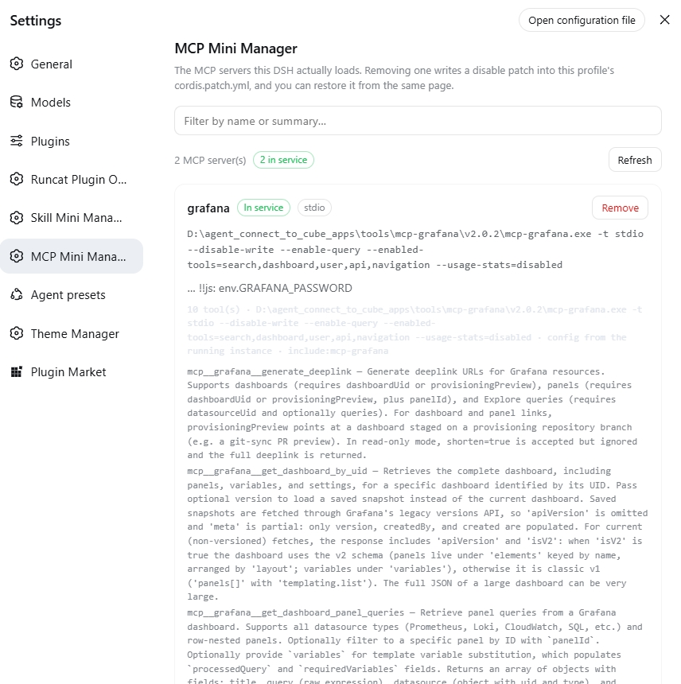

# dsh-mcp-mini-manager

[中文](README.md) | English

**MCP Mini Manager** for DSH: one Settings page, at the same sidebar level as Plugins, that lists every MCP server this DSH actually loads — with each server's summary and live state — and takes any of them out of service.

- **Plugin id**: `dsh-mcp-mini-manager`
- **Chinese name**: MCP 极简管理
- **English name**: MCP Mini Manager
- **Settings page id**: `mcp-mini-manager` (`settings.section`, order 16, right after Plugins)



## What it fixes

DSH has no single place that shows which MCP servers are installed. Finding out means reading `cordis.patch.yml`, then the patch layers of every bundle, and deciding by hand which rows are MCP; removing one has no UI entry point at all. This page makes both a one-step operation.

## How it can know which MCP servers exist

This is the one design point worth explaining.

In DSH **an MCP server is exactly one row in the cordis loader tree**, whose module is `@deepseek-ai/dsh-mcp-client`. That package's own type docs say so:

> MCP client bridge plugin: connects to an external MCP server and registers its tools on `ctx.tools` … **Each plugin instance connects to one MCP server; load multiple instances in `cordis.yml` for multiple servers.**

So "which MCP servers are installed" is "which `ctx.loader` entries are `dsh-mcp-client`". This plugin reads **two** sources and reconciles them:

| Source | Provides | Limitation |
|---|---|---|
| **The live Loader** (`ctx.loader.entries()`) | Authoritative `config` (`serverName` / `transport` / `command` / `url` …) and the real fiber state | **Blind to disabled rows** — a disabled row is not in the tree at all |
| **The patch layers** (each bundle's `cordis.patch.yml`, the profile's own, and `~/.dsh/cordis.patch.yml`) | Disabled rows, and which package declared each one | Static config only, no runtime state |

Merged, a server you removed yesterday still appears — with a "removed" state and its original config recovered from the removal record. The merge rule is: **the live tree wins on anything it can see**, and the layers supply exactly what the tree structurally cannot.

The page holds one boundary strictly: **the browser never sends a path, and never sends YAML.** Every request carries a single **row id** that this plugin's own catalog reported; the host re-confirms that the row really is an MCP client row before deriving which file to write and which block to write into it.

## How removal works

"Remove" appends an id-targeted disable patch to **the profile's own** `cordis.patch.yml`:

```yaml
# >>> dsh-mcp-mini-manager: disabled mcp row mcp-github
# server: github
# removed: <ISO timestamp> by dsh-mcp-mini-manager
# restore this server from the MCP 极简管理 settings page, or delete
# these lines to re-enable the row by hand.
- id: mcp-github
  disabled: true
# <<< dsh-mcp-mini-manager: disabled mcp row mcp-github
```

That route has three deliberate properties:

1. **No package file is ever touched.** The target row may come from `dsh-base`, `dsh-web-app` or a third-party bundle's patch layer, and those directories belong to the packages — a reinstall would undo any edit. The disable goes into the **user layer**, the one `dsh-app-boot` applies on every boot and the one the user edits.
2. **No restart needed.** DSH calls `watchUserPatches` on the profile and home layers at startup, so a write is reparsed and reapplied in process. After writing, the host **re-reads the live tree** and reports honestly whether the change is "already in effect" or "takes effect after a restart", instead of promising on its own authority.
3. **Recoverable.** Before the patch is written, the original row is recorded under `<harness home>/.mcp-mini-manager/removed/<rowId>.json`. "Restore" does exactly one thing: delete that disable block. Disable-then-restore is a **byte-for-byte** no-op — your own comments, `!!js` expressions and other plugins' patches are untouched, because the write is a **line splice**, not a YAML re-serialization.

> **Why not parse and re-serialize the YAML.** That file is hand-written and shared by every plugin. Any "parse → modify → re-emit" round trip reorders or rewrites comments and `!!js` expressions, quietly breaking unrelated plugins. So this plugin only inserts and deletes whole marked line ranges, and every range carries its own begin/end markers.

### Refusals, all deliberate

| Situation | Behavior |
|---|---|
| The row is already disabled | Refused (`already-disabled`); the file is untouched |
| Unpaired markers (hand-edited, or an interrupted write) | Refused (`marker-unpaired`) — the block's extent is unknown, so neither a splice nor a delete can be bounded honestly |
| The patch file does not end with a newline | Refused (`no-trailing-newline`) — restore would stop being exact |
| A path-shaped row id (`a/b`, `../x`, `C:\x`) | Refused by grammar (`bad-row-id`) before any filesystem use |
| A request from another origin (`Origin` ≠ `Host`) | Refused with 403 |

**When the user layer already holds a patch for this row, the disable is written anyway.** This is worth stating, because the instinct is that a duplicate id must be refused: `applyEntryPatches` applies every patch **independently, key by key**, so a patch carrying only `id` + `disabled` composes safely alongside one carrying `name` + `config` — that is exactly how DSH itself layers patches. It also means the most common shape of all, an MCP row declared through `insert`, stays removable; otherwise most rows on the page would become un-actionable.

"Clear removal records" is this plugin's only irreversible verb. It deletes record files only — it restores and removes nothing — and requires a second confirmation.

## What else the page shows

- **Summary**: one line per server — the command line for stdio, the endpoint for streamable-http. Fields whose config holds a `!!js` expression are flagged by name (**names only; values are never shown**).
- **State**: `in service` / `removed` / `failed to start` / `starting` / `unobserved`, derived once from the fiber state plus the patch layers so two contradictory badges can never appear.
- **Tools**: the tools that server registers for the model as `mcp__<serverName>__<rawName>`, with their descriptions.
- **Plugins that appear to speak MCP themselves (read-only)**: some plugins consume MCP on their own and choose their own tool names, not through `dsh-mcp-client`. Removing one would be uninstalling a plugin — a different act — so they are listed with no action offered.
- **Diagnostics**: the profile directory, the write target, the home-layer patch, which patch layers were read, and anything in them the subset parser could not represent.

### One limitation, stated plainly

A fiber in state `active` **only means the plugin loaded; it does not mean the server connected.** Connection and reconnect state is reported to the log only (`dsh-mcp-client` logs reconnecting / recovered / final failure), and this plugin does not guess at it. The page says so in its own footer.

## Install

This is a standard DSH bundle (it declares `dsh.bundle.patch` and `dsh.client`): install the package into a profile and **restart `dsh web` once**. All three routes below work; they differ only in whether you need `git`, whether a build approval can be triggered, and how you update later.

### ① Straight from GitHub

```bash
dsh plugin --profile web add github:runcat-tommy/dsh-mcp-mini-manager
```

- **For**: using it without cloning anything.
- **Watch out**: needs `git` on the machine. The repository **already commits every runtime artifact** (`lib/`) and declares no `preinstall`/`install`/`postinstall`/`prepare` script, so a build approval is usually not triggered; if DSH asks anyway, approve it.
- **Update**: rerun the same command.

### ② Clone it and install locally

```bash
git clone https://github.com/runcat-tommy/dsh-mcp-mini-manager.git
dsh plugin --profile web add D:\path\to\dsh-mcp-mini-manager
```

(A downloaded ZIP extracted anywhere works just as well — point at that directory.)

- **For**: changing the code, pinning a version, or a machine that cannot reach npm.
- **Watch out**: no build approval. `dsh plugin` is really a `pnpm` forwarding shell — it runs `pnpm add` inside the profile directory and then aligns `dsh.profile.bundles` to the **real loaded state**. So you can also mount it by hand with `pnpm add link:<path>`, in which case you must add the package name to `dsh.profile.bundles` yourself (`pnpm add` will not):

  ```json
  {
    "dsh": {
      "profile": {
        "bundles": ["@deepseek-ai/dsh-base", "@deepseek-ai/dsh-web-app", "dsh-mcp-mini-manager"]
      }
    }
  }
  ```

- **Update**: `git pull` → rerun `dsh plugin --profile web add D:\path\to\dsh-mcp-mini-manager` → restart.

### ③ From npm

```bash
dsh plugin --profile web add dsh-mcp-mini-manager
```

- **For**: the least effort; the tarball ships the full artifacts and `prepare` does not run on install.
- **Watch out**: the npm version may lag GitHub `main`; take ① or ② to live on the edge.
- **Update**: `dsh plugin --profile web up dsh-mcp-mini-manager`.

### The three side by side

| | Command | Requires | Build approval | Update |
|---|---|---|---|---|
| ① GitHub | `… add github:runcat-tommy/dsh-mcp-mini-manager` | `git` on the machine | Usually none (artifacts committed, no install scripts) | Rerun the same command |
| ② Local clone | `git clone …` then `… add D:\path\to\repo` | nothing | none | `git pull` + rerun `add` + restart |
| ③ npm | `… add dsh-mcp-mini-manager` | nothing | none | `… up dsh-mcp-mini-manager` |

**All three require one `dsh web` restart** — a new bundle is read from the profile manifest at startup, so refreshing the page is not enough (the page will say its host half did not answer). Once installed, **disabling and restoring an MCP server never needs a restart**: the write goes into the profile's own patch layer, which DSH hot-reloads.

Inspect and uninstall:

```bash
dsh plugin --profile web list                        # what is installed
dsh plugin --profile web remove dsh-mcp-mini-manager # uninstall the plugin (not the same as disabling an MCP)
```

## What ships

| File | Role |
|---|---|
| `lib/index.js` | Host half: five HTTP routes, reads the Loader and every patch layer, owns the writes and their guards |
| `lib/catalog.js` | Pure core: row classification, config projection, patch-layer parsing, `planDisable` / `planRestore` |
| `lib/client.js` | Browser half: a hand-written `__ModuleLoader__` bundle registering `settings.section` |
| `cordis.patch.yml` | Bundle patch: inserts one row into this profile's loader tree |
| `test/` | 81 tests: pure rules, host integration (real temp dirs + layered patches), browser-half structure |
| `scripts/verify-e2e.mjs` | End-to-end smoke: loads both real entry points in one process and runs the full cycle (`npm run smoke`) |

The browser half needs **no build step**: it requires only the platform's `react` seed and talks to the host half over same-origin `fetch`. Copy is registered in both Chinese and English through the `locale` service, so it follows the DSH UI language.

## Host interface

These routes mount on DSH's `webServer` and sit **outside the `/api` gateway's same-origin fence**. `Host` is the one header a hostile page cannot forge, so every request that carries an `Origin` is admitted only when it matches `Host`, and is refused with 403 otherwise. Requests that deliberately carry no `Origin` (curl, scripts) are admitted, because those are not browser-initiated cross-site requests and such a caller already holds local filesystem access.

| Method | Path | Role |
|---|---|---|
| `GET` | `/dsh-mcp-mini-manager/api/catalog` | The catalog: every MCP row + removal records + diagnostics |
| `GET` | `/dsh-mcp-mini-manager/api/rows` | Raw rows (for debugging) |
| `POST` | `/dsh-mcp-mini-manager/api/disable` | Take one MCP out of service (body: `{rowId}`) |
| `POST` | `/dsh-mcp-mini-manager/api/restore` | Restore one MCP (body: `{rowId}`) |
| `POST` | `/dsh-mcp-mini-manager/api/purge` | Clear removal records (**the only irreversible verb**; deletes records only, restores and removes nothing) |

## Development

```bash
npm test          # 81 tests: catalog pure logic + host integration + browser-half structure
npm run smoke     # end-to-end: loads both real entry points in one process and runs the full cycle
```

- `lib/catalog.js` — pure functions: row classification, config projection, patch-layer parsing, disable/restore plans.
- `lib/index.js` — host half: mounts `webServer` routes, reads the Loader and every patch layer.
- `lib/client.js` — browser half: a hand-written ModuleLoader bundle requiring only the platform's `react`.

Two checks in `npm test` are worth calling out:

- **The client test checks every CSS custom property the stylesheet reads against the installed DSH theme's own token definitions.** A mistyped token name fails nothing at runtime — it just silently renders unstyled — so that assertion earns its place.
- **The fake Loader in `scripts/verify-e2e.mjs` composes patch layers by `applyEntryPatches`' real semantics** (each patch independently, key by key), so the disable → restore round trip is verified against real composition semantics rather than a guess at them.

The smoke script points `$DSH_HOME` at a scratch directory on purpose: removal records live under the harness home.

## Known boundaries

- **A `loader` service is required** to list the running rows; when it is unreadable the page says so rather than showing "no MCP servers".
- **Tools only**: `dsh-mcp-client` itself does not bridge resources or prompts, so neither does this page.
- **The patch-layer reader is a subset**: block mappings and sequences, quoted scalars, `!!js`, comments, and the empty-list sentinel `[]` that the profile template ships. It does not support multi-line flow collections, anchors/aliases, block scalars or merge keys — anything unsupported is reported in diagnostics rather than guessed at.
- **Multiple profiles**: the write target is always the running profile's user layer, derived from the Loader's `baseUrl`.

## License

MIT

See [CHANGELOG.md](CHANGELOG.md) for the change history.
